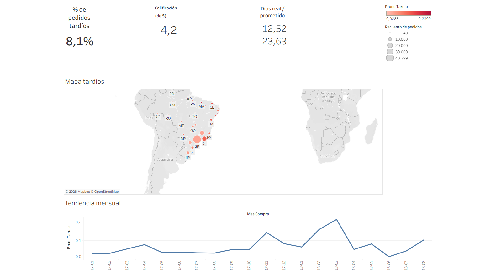

# Torre de control logística: ¿qué pedidos van a llegar tarde?

Proyecto de analítica y machine learning sobre **96.000 pedidos reales** de un marketplace de e-commerce de Brasil (Olist, 2017-2018). Incluye un pipeline en **BigQuery**, análisis estadístico, un **modelo que detecta pedidos con riesgo de retraso** y un **dashboard en Tableau**.



## Pregunta de negocio

¿Qué tan grande es el problema de las entregas tardías, dónde y cuándo ocurre, cuánto daña la experiencia del cliente y se puede avisar *antes* de que pase?

## Datos

[Brazilian E-Commerce Public Dataset by Olist](https://www.kaggle.com/datasets/olistbr/brazilian-ecommerce) (Kaggle): pedidos, ítems, pagos, reseñas, clientes, vendedores, productos y geolocalización. Los datos **no se incluyen en este repositorio**; hay que descargarlos de Kaggle.

Se usan los pedidos desde 2017-01 (96.203 pedidos con la información completa).

## Cómo se hizo

1. **BigQuery (SQL):** carga de 9 tablas, limpieza, uniones con CTE y una tabla analítica por pedido (`pedidos_modelo`): fecha, estados del cliente y del vendedor, distancia en km entre ambos (funciones geográficas), peso, volumen, precio, flete, días prometidos, días reales y reseña.
2. **Indicadores:** porcentaje de pedidos tardíos, días reales contra prometidos, calificación promedio, por estado y por mes.
3. **Estadística:** el efecto del retraso en las reseñas (regresión logística con controles).
4. **Modelo de riesgo:** clasificación de pedidos tardíos usando solo información disponible *al momento de comprar* (sin fuga de datos), con validación en el tiempo.
5. **Dashboard (Tableau):** indicadores, mapa de Brasil por estado y tendencia mensual.

## Resultados principales

- **8,1 % de los pedidos llegan tarde** (después de la fecha prometida). Los pedidos tardan en promedio **12,5 días** en llegar y se prometen **23,6 días**: en promedio se promete casi el doble de lo que se tarda, pero aun así ocurre el retraso.
- **El problema no es uniforme:** por estado, el porcentaje de pedidos tardíos va de **2,9 % a 24 %**. SP (el estado con más pedidos) tiene pocos retrasos; RJ combina volumen alto y retraso alto; estados pequeños del noreste (por ejemplo AL y MA) están entre los peores.
- **No es estable en el tiempo:** el retraso se dispara en **noviembre de 2017** (cerca de 14 %) y en **febrero-marzo de 2018** (16 % y más de 21 %), frente a una base de 3 a 5 %.
- **Impacto en el cliente:** un retraso de más de 3 días multiplica por ~27 las probabilidades de recibir una reseña de 1-2 estrellas (regresión logística con controles), lo que equivale a unas **3.400 reseñas negativas** atribuibles. La calificación promedio es **4,2 de 5**.
- **Modelo de alerta temprana:** validado en **11 ventanas mensuales** (entrenar con el pasado, probar en el mes siguiente). Si se revisa el **10 % de pedidos con mayor riesgo**, se detecta **1 de cada 4 retrasos** (2,5 veces mejor que elegir al azar).

## Lo que aprendí (y lo que no funcionó)

- El modelo más simple (**regresión logística**) con dos variables clave le ganó a modelos más complejos al evaluarlo mes a mes. La variable más útil fue el **"colchón"**: días prometidos menos el tiempo típico de esa ruta, calculado solo con datos de entrenamiento.
- Varias hipótesis mías resultaron falsas: quitar el mes del modelo no ayudó, y añadir más contexto operativo empeoró los resultados. Escoger variables mirando el conjunto de prueba lo contamina, así que se evaluó con ventanas mensuales.
- Hubo **cambios de distribución** entre el entrenamiento y la prueba (un solo corte temporal engañaba), lo que justificó la validación en ventanas.

## Limitaciones

- "Tardío" se define **contra la promesa de la propia empresa**. Alargar la promesa reduce los retrasos artificialmente, y este análisis no ve el costo en ventas de prometer más días.
- Los datos son de 2017-2018 y de un solo marketplace: sirve para mostrar el método, no para generalizar a otro negocio.
- El riesgo mostrado en el dashboard se calcula sobre los mismos pedidos con los que se ajustó el modelo (no es una predicción a futuro).
- El impacto en reseñas es una **asociación**, no prueba causal.

## Próximos pasos

- Pronóstico de demanda por región (semanal) con Black Friday como variable externa.
- Gráfico de control (p-chart) del porcentaje mensual de retrasos y pruebas de hipótesis entre estados.
- Intervalos de confianza (bootstrap) para las métricas del modelo.

## Estructura

```
torre-control-logistica/
├── README.md
├── notebooks/
│   └── olist_torre_control.ipynb
└── docs/img/
    └── dashboard_torre_control.png
```

## Cómo reproducirlo

1. Descargar el dataset de Olist desde Kaggle y cargarlo a un proyecto propio de BigQuery (el modo gratuito, *sandbox*, alcanza).
2. Abrir `notebooks/olist_torre_control.ipynb` en Google Colab, cambiar el nombre del proyecto de BigQuery por el tuyo y ejecutar las celdas en orden.

## Herramientas

Google BigQuery (SQL) · Python (pandas, NumPy, scikit-learn, statsmodels, matplotlib) · Google Colab · Tableau
